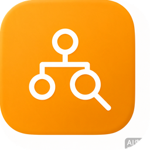

# MedDRA Browser



在本机浏览 MedDRA 术语、层级和 SMQ，也可导入 Data Listing 做批量编码审阅。界面为中文，可按已导入版本切换中文、英文和双语。应用不含 MedDRA 词典，使用前请准备自己有权使用的 ASCII 发行文件夹。

## 下载与打开

在 [GitHub Releases](https://github.com/smkzw/meddra-browser-mac/releases) 下载完整压缩包，解压后再打开。

| 下载 | 适用系统 | 打开方式 |
| --- | --- | --- |
| `meddra-browser-mac-app.zip` | macOS 12 及以上，Apple 芯片或 Intel | 将应用拖到「应用程序」，双击打开 |
| `meddra-browser-portable.zip` | macOS 12 及以上，64 位 Windows 10/11 | 解压到可写目录，双击该系统的第一步文件 |

两个包都自带 Python 和运行依赖。安装和首次启动可以离线。Mac App 在自己的窗口内运行。便携版启动窗口显示地址后会自动打开浏览器。若浏览器没有打开，可打开同目录的第二步 HTML，或把启动窗口显示的地址复制到浏览器。

Mac 包采用本地签名。首次打开如果出现开发者验证提示，请先确认来源和 Releases 中的 `SHA256SUMS.txt`。设备策略允许时，可在「系统设置 → 隐私与安全性」处理本次打开授权。操作路径见 [Apple 支持](https://support.apple.com/zh-cn/102445)。

## 首次导入词典

1. 在工作台点「选择词典文件夹」。也可从「设置」进入。
2. 选择包含 `soc.asc`、`pt.asc`、`llt.asc`、`mdhier.asc` 等文件的目录，或者包含多个语言、版本词典的上级文件夹。完整的 `MedAscii`、`ascii-291` 及其发行包外层目录均可。
3. 选择版本并等待索引完成。界面会显示当前版本的语言与索引状态。添加另一种语言后，可以更新到同版双语索引。
4. 词典路径和索引会留在本机。移走原文件夹、切换系统或便携包换电脑后，应在「设置」重新选择可访问的词典路径。

Mac App 沿用原版 `~/Library/Application Support/MedDRA Browser Mac/data` 中的词典路径配置。便携版将配置与缓存保存在解压目录的 `backend/data`。

## 查询与编码审阅

- 搜索支持中文、英文、代码、层级与 SOC 筛选。可展开 SOC 至 LLT 的层级路径，浏览 SMQ 父子关系及期望的范围标签。
- 将条目加入 Research Bin 后，可导出 CSV 或 JSON。
- 在「批量编码」导入 CSV、XLSX Data Listing，或粘贴待编码术语。逐条核对当前词典的候选和原始术语，确认或改码后导出。编码时建议和人工决定分开，导出包含词典版本与来源行定位。
- 编码工作在本机处理。自动建议仅供定位候选，所有编码决定须人工核对。离开电脑前请导出要保留的审阅结果。

## 关闭、退出与更新

- **Mac App**。关闭工作台窗口或按 `⌘Q` 可退出 App 和它启动的本地服务。
- **便携版**。工作完成后点击「退出便携版」，或在启动窗口按 `Ctrl+C`。只关浏览器标签页时服务仍在，重新运行第一步可打开已有会话。
- **重启**。Mac App 启动故障时在窗口中选择「重新启动」或「查看启动日志」。便携版若连不上，检查启动窗口是否报错，再从第一步启动。
- **更新**。退出后替换 Mac App。便携新版应解压到新目录，首次使用重新选择词典。旧工作中的导出文件请单独保留。

## 构建与测试

本仓库使用 React、TypeScript、FastAPI 与 SQLite FTS5。开发环境需要 Node.js 22.12 或更高版本。构建发布包需要 macOS、Apple SDK、Python 3.12+ 及 `uv`。

```bash
(cd frontend && npm ci && npm run build)
./scripts/start_meddra_server.sh
```

在浏览器打开启动窗口显示的地址。开发测试请显式设置本地已获授权词典目录和临时状态目录。

```bash
python3 -m pip install -r backend/requirements-dev.txt
MEDDRA_SOURCE_ROOT="/path/to/licensed/MedDRA" \
MEDDRA_BROWSER_STATE_DIR="$(mktemp -d)" PYTHONPATH=backend \
  python3 -m unittest discover -s backend/tests -v
```

```bash
./scripts/build_free_release.sh
```

产物在 `build/`。构建器校验 CPython 归档 SHA-256，按目标系统架构安装 [锁定的依赖](scripts/runtime-requirements.txt)。分发包保留 Python 和依赖的许可证说明。独立 Python 运行时来自 [Astral Python Build Standalone](https://github.com/astral-sh/python-build-standalone/releases/tag/20261110)。发布包卫生检查覆盖原始词典、缓存及构建机路径。关于分发与系统验证提示，参见 [ZIP 分发](docs/no-apple-developer-program-distribution-zh.md) 与 [App Store 准备说明](docs/app-store/APP_STORE_SUBMISSION_ZH.md)。

## License

This repository is source-available under the [MedDRA Browser Personal Non-Commercial License](LICENSE.md). MedDRA data are governed by the applicable MedDRA/MSSO/ICH license terms.
